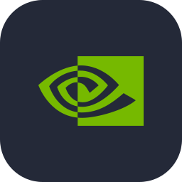
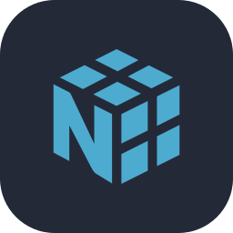

<!-- Banner -->
<p align="center">
  <picture>
    <source media="(prefers-color-scheme: dark)" srcset="icons/banner-dark.svg"/>
    
  </picture>
</p>

<p align="center">
  <a href="https://www.linkedin.com/in/ammar-malik-767443413/"></a>
  <a href="mailto:am0016408@gmail.com"></a>
  <a href="https://github.com/Ammar-S-Malik"></a>
</p>

---

## Featured Projects

### MiniInfer · GPT-2 Inference Engine

GPT-2 rebuilt from scratch in PyTorch with KV-cached generation, CUDA-graph decoding and a continuous-batching scheduler that admits and retires requests mid-flight.

| | |
|---|---|
| **Stack** | Python · PyTorch · CUDA · HuggingFace Transformers |
| **Performance** | **3.1×** the throughput of HuggingFace's reference implementation (**23.7K tokens/s** at batch 64, fp16); **5.3×** for a single request |
| **Scheduling** | Continuous batching with a per-slot KV cache: up to **1.7×** the throughput of static batching, **6–8 ms** median time-to-first-token under load |
| **Correctness** | Exact token-level parity with the HuggingFace GPT-2 reference; unit tests run in CI with GitHub Actions |
| **Repository** | [Ammar-S-Malik/mini-inference-engine](https://github.com/Ammar-S-Malik/mini-inference-engine) |

### Endgame · UCI Chess Engine

A UCI chess engine in Rust with no external crates: bitboard move generation, alpha-beta search and an NNUE evaluation network trained on self-play.

| | |
|---|---|
| **Stack** | Rust · PyTorch · NNUE · UCI |
| **Strength** | **+182 Elo** over baseline via automated SPRT testing; **53%** over 500 games vs Stockfish capped at 2700 Elo |
| **Search** | Iterative-deepening alpha-beta, late move reductions, transposition table |
| **Evaluation** | Quantized integer NNUE inference with incrementally updated accumulators |
| **Correctness** | Perft-verified move generation |
| **Repository** | [Ammar-S-Malik/endgame](https://github.com/Ammar-S-Malik/endgame) |

### Hitscan · Multiplayer Browser FPS

A real-time multiplayer 3D shooter with a server-authoritative 60 Hz simulation, lobbies, quick play and timed rounds.

| | |
|---|---|
| **Stack** | TypeScript · Three.js · Node.js · WebSockets · Vite |
| **Scale** | **64** concurrent players at a **1.5 ms** average server tick |
| **Netcode** | Client-side prediction, server reconciliation, lag-compensated hit detection |
| **Reliability** | Automated test suite, security controls, CI with GitHub Actions |
| **Play it** | [hitscan.pages.dev](https://hitscan.pages.dev/) |
| **Repository** | [Ammar-S-Malik/Hitscan](https://github.com/Ammar-S-Malik/Hitscan) |

---

## About

I'm a Computer Science student at Seneca College and a contract software engineer. I like building the layer underneath things: inference engines, search algorithms, game netcode and serverless backends. I care most about measurable results, so all of my projects come with a benchmark.

---

## Tech Stack

<p align="center"><b>Languages</b></p>

<p align="center">
  
  
  
  
  
  
  
  
</p>

<p align="center"><b>Frameworks & Libraries</b></p>

<p align="center">
  
  
  
  
  
  
  
</p>

<p align="center"><b>Cloud, Infra & Tools</b></p>

<p align="center">
  
  
  
  
  
  
  
  
  
  
  
  
  
</p>

---

## Engineering Focus

| Domain | Details |
|---|---|
| **ML Inference** | KV caching, continuous batching, CUDA graphs, throughput and latency benchmarking, PyTorch/CUDA |
| **Systems & Performance** | Bitboards, search, quantized inference, Rust with zero dependencies |
| **Testing & Benchmarking** | SPRT Elo testing, perft checks, token-parity tests, load tests, CI |
| **Real-time Networking** | Authoritative servers, prediction/reconciliation, lag compensation |

---

## Experience

**Contract Software Engineer · Transbiz Truck Training / Transbiz Auto Traders** · *June 2026 – Present* · Toronto, ON

- Designed and shipped a full-stack dealership web app with searchable vehicle inventory, financing information and customer inquiry workflows.
- Built a serverless backend on Cloudflare Workers and D1 (SQLite) with R2 object storage and CRUD APIs for inventory and leads.
- Built an admin dashboard secured with Cloudflare Access, using Resend to route customer inquiries to multiple administrators.

---

## Current Focus

```yaml
studying:   Computer Science @ Seneca College
working:    Contract Software Engineer @ Transbiz
building:   my next systems project (bigger than MiniInfer)
open_to:    SWE / ML infrastructure internships
```

<p align="center">
  
</p>
